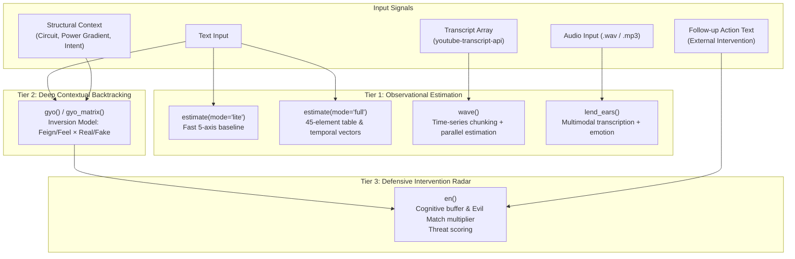

# Emotionics

[](https://pypi.org/project/emotionics/)
[](https://pypi.org/project/emotionics/)

Emotionics is a **structural framework** for estimating emotional signals and dynamics from text and audio.  
It estimates — **it does not diagnose, judge, or determine emotions**.

Emotionics is engineered to be:
- **Provider-neutral**: Bring your own LLM (OpenAI, Google Gemini, or custom backends).
- **Structure-first**: Focuses on emotional physics, power gradients, and communicative circuits rather than subjective sentiment scores.
- **Responsibility-explicit & Ethically constrained**: Acts as an observational sensor, strictly prohibiting autonomous psychological manipulation.

---

## Table of Contents
- [Architecture & Flow](#architecture--flow)
- [Installation](#installation)
- [Quick Start](#quick-start)
  - [1. Activation](#1-activation)
  - [2. Basic Estimation (`lite` & `full`)](#2-basic-estimation-lite--full)
- [Time-Series Emotion Waves (`emotionics.wave`)](#time-series-emotion-waves-emotionicswave)
  - [Concept: Time-Series Emotional Trajectory](#concept-time-series-emotional-trajectory)
  - [Parameters](#parameters)
  - [Code Example & Output Structure](#code-example--output-structure)
- [Deep Contextual Backtracking (`emotionics.gyo`)](#deep-contextual-backtracking-emotionicsgyo)
  - [Why Contextual Backtracking Matters](#why-contextual-backtracking-matters)
  - [Parameters](#parameters-1)
  - [The Inversion Model & 4 Quadrants](#the-inversion-model--4-quadrants)
  - [Code Example & Output Structure](#code-example--output-structure-1)
  - [Parallel Gradient Simulation (`emotionics.gyo_matrix`)](#parallel-gradient-simulation-emotionicsgyo_matrix)
- [Defensive Intervention Radar (`emotionics.en`)](#defensive-intervention-radar-emotionicsen)
  - [Concept: Cognitive Intervention Defense](#concept-cognitive-intervention-defense)
  - [The Threat Formula & Multiplier Matrix](#the-threat-formula--multiplier-matrix)
  - [Code Example & Output Structure](#code-example--output-structure-2)
- [Frictionless Audio Observation (`emotionics.lend_ears`)](#frictionless-audio-observation-emotionicslend_ears)
- [What Emotionics Does and Does Not Do](#what-emotionics-does-and-does-not-do)
- [LLM Provider Architecture](#llm-provider-architecture)
  - [Built-in Thin Wrappers](#built-in-thin-wrappers)
  - [Local LLM Support](#local-llm-support)
  - [Custom Providers](#custom-providers)
- [Ethical Notes](#ethical-notes)
- [Spatial Dual License (Kármán Line Provision)](#spatial-dual-license-kármán-line-provision)

---

## Architecture & Flow

Unlike conventional sentiment analysis tools that only assign scalar polarity (positive/negative), Emotionics operates as a multi-tier observational stack:



---

## Installation

Install the released version from PyPI:
```bash
pip install emotionics
```

To use built-in provider wrappers, install with optional dependencies:
```bash
# For Google Gemini support
pip install "emotionics[gemini]"

# For OpenAI support
pip install "emotionics[openai]"

# For both
pip install "emotionics[openai,gemini]"
```

*Note: Emotionics does not ship pre-bundled API keys or hosted models. All LLM credentials remain strictly under your control.*

---

## Quick Start

### 1. Activation
Emotionics requires explicit activation before use. This ensures zero implicit API calls or hidden costs.

```python
import os
import emotionics

# Activate with OpenAI
emotionics.activate(
    llm="openai",
    api_key=os.environ["OPENAI_API_KEY"],
    model="gpt-4o",
)

# Or activate with Google Gemini:
# emotionics.activate(
#     llm="gemini",
#     api_key=os.environ["GEMINI_API_KEY"],
#     model="gemini-2.5-flash",
# )
```

### 2. Basic Estimation (`lite` & `full`)

#### `mode="lite"` (Low-latency 5-axis estimation)
Ideal for real-time applications, chat interfaces, and lightweight triage.

```python
result = emotionics.estimate(
    text="I was really nervous about the presentation, but the team supported me and it went great!",
    mode="lite",
)
print(result)
```

**Example Output:**
```json
{
  "mode": "lite",
  "version": "0.9.0",
  "trust": 0.85,
  "surprise": 0.20,
  "joy": 0.75,
  "fear": 0.10,
  "confidence": 0.88
}
```

#### `mode="full"` (45-element Periodic Table & Temporal Trajectory)
Performs multi-dimensional analysis against 45 canonical emotion categories, tracking temporal orientation and conversational nuance.

```python
result = emotionics.estimate(
    text="You think you've won, but wait until the audit results come out next week.",
    mode="full",
)
print(result)
```

**Output details include:**
- `candidate_emotions`: Top 5 ranked emotional elements with confidence scores.
- `temporal`: Subjective orientation (`past`, `present`, or `future`) and temporal distance `d`.
- `temporal_distribution`: Probabilistic spread across past/present/future.
- `meta_metrics`: Scores for `intensity`, `politeness`, `sarcasm`, `directness`, and `honesty_cues`.

---

## Time-Series Emotion Waves (`emotionics.wave`)

### Concept: Time-Series Emotional Trajectory
Human speech, video presentations, interviews, and podcasts evolve dynamically over time. Analyzing an entire transcript as a single flat block obscures critical emotional inflection points—such as sudden shifts into defensiveness, mounting anxiety, or breakthroughs of confidence.

`emotionics.wave()` processes timestamped transcripts (e.g., from `youtube-transcript-api` or ASR pipelines), groups utterances into fixed time intervals (default: **15.0 seconds**), and executes parallel emotion estimation via `concurrent.futures.ThreadPoolExecutor` across all chunks while strictly preserving chronological timeline order.

### Parameters

| Parameter | Type | Default | Explanation |
| :--- | :--- | :--- | :--- |
| `transcript_data` | `list[dict]` | *Required* | List of transcript items containing at least `text` and `start` (seconds). Compatible with `youtube-transcript-api`. |
| `interval` | `float` | `15.0` | Time window for grouping and merging text chunks (in seconds). |
| `mode` | `str` | `"lite"` | Analysis mode for each chunk: `"lite"` (fast 5-axis) or `"full"` (45-element table & temporal vectors). |
| `max_workers` | `int` | `min(10, N)` | Concurrency limit for parallel ThreadPoolExecutor execution across chunks. |

### Code Example & Output Structure

```python
import emotionics

emotionics.activate(
    llm="openai",
    api_key="YOUR_OPENAI_API_KEY",
    model="gpt-4o",
)

# 1. Transcript data (e.g., from youtube-transcript-api or speech-to-text)
transcript = [
    {"text": "Welcome everyone. Today we have an important announcement regarding our roadmap.", "start": 0.5, "duration": 4.0},
    {"text": "We encountered critical unexpected roadblocks earlier this quarter that delayed our launch.", "start": 5.8, "duration": 5.2},
    {"text": "However, the engineering team rallied and engineered an outstanding breakthrough.", "start": 16.0, "duration": 5.0},
    {"text": "I am thrilled to finally reveal our new architecture today!", "start": 22.5, "duration": 4.1},
]

# 2. Analyze emotional wave across 15-second intervals (parallel execution)
wave_result = emotionics.wave(
    transcript_data=transcript,
    interval=15.0,
    mode="lite",  # or "full"
)

print(wave_result)
```

**Example Output:**
```json
{
  "mode": "wave",
  "version": "0.9.0",
  "interval": 15.0,
  "timeline": [
    {
      "time_start": 0.0,
      "time_end": 15.0,
      "text": "Welcome everyone. Today we have an important announcement regarding our roadmap. We encountered critical unexpected roadblocks earlier this quarter that delayed our launch.",
      "analysis": {
        "mode": "lite",
        "version": "0.9.0",
        "trust": 0.72,
        "surprise": 0.35,
        "joy": 0.15,
        "fear": 0.65,
        "confidence": 0.88
      }
    },
    {
      "time_start": 15.0,
      "time_end": 30.0,
      "text": "However, the engineering team rallied and engineered an outstanding breakthrough. I am thrilled to finally reveal our new architecture today!",
      "analysis": {
        "mode": "lite",
        "version": "0.9.0",
        "trust": 0.90,
        "surprise": 0.20,
        "joy": 0.88,
        "fear": 0.05,
        "confidence": 0.94
      }
    }
  ]
}
```

---

## Deep Contextual Backtracking (`emotionics.gyo`)

### Why Contextual Backtracking Matters
Human speech is rarely literal. Individuals regularly feign emotions due to social pressure, power imbalances, or defense mechanisms:
- A junior employee may sound excessively cheerful while in distress.
- An online commentator may project righteous fury to mask deep humiliation or status anxiety.
- A public figure under scrutiny may project calm indifference while in acute panic.

Surface-level sentiment analysis takes these performances at face value. `emotionics.gyo()` performs **structural backtracking**—calculating the delta between the public facade and the true hidden emotional state ($O$).

### Parameters
Instead of passing concrete platform names (e.g., "twitter") or specific personas, `gyo()` takes abstracted structural coordinates:

| Parameter | Type | Valid Values / Examples | Explanation |
| :--- | :--- | :--- | :--- |
| `text` | `str` | `"Don't flatter yourself! People like you are completely ruining this industry and I will never let this go!"` | The text to analyze. |
| `subject` | `str` | `"Anonymous commentator"`, `"Subordinate"`, `"Executive"` | Role and social positioning of the speaker. |
| `circuit` | `str` | `"1:1"`, `"1:N"`, `"N:1"`, `"N:N"` | **Network Topology**: <br>• `"1:1"`: Private dialogue (DMs, 1-on-1 meetings)<br>• `"1:N"`: Broadcast (speeches, influencer posts)<br>• `"N:1"`: Group targeting (mobbing, pile-ons)<br>• `"N:N"`: Open public network (forum, timeline) |
| `power_gradient` | `str` | `"symmetrical"`, `"upward"`, `"downward"` | **Power Dynamics**: <br>• `"symmetrical"`: Equal standing (peers, friends)<br>• `"upward"`: Lower speaking to higher (defensive, excuses)<br>• `"downward"`: Higher speaking to lower (authority exercise) |
| `intent` | `str` | `"Moral grandstanding / Counter-attack"`, `"Seeking validation"`, `"Defensive de-escalation"` | Situational stance or strategy. |

### The Inversion Model & 4 Quadrants
The GYO engine grounds LLM reasoning in two foundational models:

1. **Emotionics 2.0 Inversion Formulas**:
   - **Fear $\rightarrow$ Pride**: Projecting arrogance to conceal underlying vulnerability.
   - **Shame $\rightarrow$ Anger**: Converting unbearable guilt or inadequacy into externalized, righteous hostility.
   - **Uncertainty $\rightarrow$ Overconfidence**: Making dogmatic assertions to hide internal doubt.
   - **Doubt $\rightarrow$ Excessive Claims**: Over-promising to suppress anxiety.

2. **The Feel/Feign $\times$ Real/Fake Quadrants**:
   - **Feel Real**: Genuine internal emotion (typical in symmetrical 1:1 interactions).
   - **Feel Fake**: Emotional contagion or groupthink (common in viral N:N threads; external pressure mistaken for internal feeling).
   - **Feign Real**: Strategic regulation or conscious suppression of genuine feelings (negotiations, diplomacy).
   - **Feign Fake**: Pure theatrical performance or manipulative display (1:N broadcasts or upward defensive posturing).

### Code Example & Output Structure
```python
import emotionics

emotionics.activate(llm="gemini", api_key="YOUR_GEMINI_API_KEY", model="gemini-2.5-flash")

result = emotionics.gyo(
    text="Don't flatter yourself! People like you are completely ruining this industry and I will never let this go!",
    subject="Anonymous online commentator",
    circuit="N:N",                 # Open social timeline
    power_gradient="symmetrical",  # Peer-to-peer dynamic
    intent="Moral grandstanding / Preemptive counter-attack",
)

print(result)
```

**Example Output:**
```json
{
  "mode": "gyo",
  "version": "0.9.0",
  "surface_layer": {
    "method": "emotionics.estimate(mode='full')",
    "perceived_emotion": "Anger / Indignation",
    "perceived_quadrant": "Feel Real Emotion (Assumed by public)"
  },
  "deep_layer": {
    "method": "emotionics.gyo()",
    "true_emotion_O": "Shame / Status Anxiety",
    "actual_quadrant": "Feel Fake"
  },
  "delta_analysis": {
    "gap": "Projects aggressive superiority, but internally driven by severe status threat and group contagion.",
    "mechanism": "Converts unacknowledged inadequacy into righteous anger via open N:N social reinforcement."
  }
}
```

---

### Parallel Gradient Simulation (`emotionics.gyo_matrix`)

In many real-world scenarios, the true power gradient between participants is unknown, ambiguous, or contested. `gyo_matrix()` runs 3 parallel simulations (`upward`, `downward`, `symmetrical`) simultaneously.

To adhere to the ethical boundaries of Emotionics, this function acts purely as a **stateless sensor**. It avoids single-number quantization bias, providing the raw structural deltas across all three gradients so that downstream moderation systems or human analysts can detect structural collapse (the approaching "Red Line").

```python
result = emotionics.gyo_matrix(
    text="Don't tell me what to do. I know exactly how this system works.",
    subject="Project Contributor",
    circuit="1:1",
    intent="Defending autonomy",
)

for gradient in ["symmetrical", "upward", "downward"]:
    data = result["results"][gradient]
    delta = data["delta_analysis"]
    print(f"\n=== {gradient.upper()} ===")
    print(f"Gap:       {delta['gap']}")
    print(f"Mechanism: {delta['mechanism']}")
```

---

## Defensive Intervention Radar (`emotionics.en`)

### Concept: Cognitive Intervention Defense
When an individual experiences an emotional peak (e.g., profound grief, panic, or volcanic rage), their cognitive defense bandwidth drops significantly. In this state, external psychological interventions (*Hatsu*) can exert disproportionate, often predatory influence.

`emotionics.en()` functions as an **early-warning defensive radar**. It evaluates an incoming message (`action_text`) directed at a subject whose emotional baseline was analyzed via `gyo()`, calculating an adversarial threat score based on temporal latency and psychological vector compatibility.

### The Threat Formula & Multiplier Matrix

The radar computes the final threat score ($S_{\text{threat}}$) using the following formula:

$$S_{\text{threat}} = \max\left(0, 1 - \frac{\Delta t}{\text{radius}}\right) \times a_{\text{peak}} \times c_{\text{match}}$$

1. **Cognitive Buffer Time Factor**:
   - $\Delta t = |t_{\text{action}} - t_{\text{original}}|$
   - `radius`: The cognitive integration window (default: **15.0 seconds**). External interventions arriving outside this window ($\Delta t > 15s$) are treated as natural conversational friction and assigned $S_{\text{threat}} = 0.0$.
2. **Acceleration at Peak ($a_{\text{peak}}$)**:
   - A normalized index ($0.0 \sim 1.0$) representing psychological instability. Large structural contradictions identified in `gyo()` (e.g., `Feign Fake` or `Feel Fake` with large gaps) yield high instability ($a_{\text{peak}} \ge 0.8$).
3. **The Evil Match Multiplier ($c_{\text{match}}$)**:
   Hostile intervention does not only take the form of direct insults. Predatory manipulation frequently masquerades as excessive affirmation or savior dynamics:

| Subject Peak State | Incoming Action Vector | Multiplier ($c_{\text{match}}$) | Threat Classification & Psychological Risk |
| :--- | :--- | :--- | :--- |
| **`LOCAL_MINIMUM`**<br>(Vulnerability, Grief, Despair) | **`plus`**<br>(Excessive validation / savior posture) | **$2.0\times$ (Critical)** | **Predatory Grooming & Exploitation**<br>Pretending to offer salvation to establish psychological dependency and control. |
| **`LOCAL_MINIMUM`** | **`sync`**<br>(Sympathy / trauma bonding) | **$1.5\times$** | **Co-dependency / Spiral Trap**<br>Reinforcing victimhood and deepening emotional paralysis. |
| **`LOCAL_MINIMUM`** | **`minus`**<br>(Blunt attack / kicking down) | **$0.5\times$** | **Direct Hostility**<br>Crude and transparent; low subtlety, easily rejected by third parties. |
| **`LOCAL_MAXIMUM`**<br>(Righteous rage, Grandiosity) | **`minus`**<br>(Surgical refutation / provocation) | **$2.0\times$ (Critical)** | **Calculated Destabilization**<br>Precision triggers designed to induce public explosion or psychological breakdown. |
| **`LOCAL_MAXIMUM`** | **`sync`**<br>(Fanatical agreement / mobbing) | **$1.5\times$** | **Echo Chamber / Mob Escalation**<br>Fueling volatile aggression into uncontrolled group action. |
| **`LOCAL_MAXIMUM`** | **`plus`**<br>(Flattery / cheering) | **$1.0\times$** | **Surface Validation**<br>Conventional social encouragement. |

### Code Example & Output Structure
```python
import emotionics

# 1. Baseline analysis of the subject's vulnerable utterance
gyo_baseline = emotionics.gyo(
    text="I gave everything to this project and they discarded me like trash. Maybe I'm just worthless.",
    subject="Former employee",
    circuit="N:N",
    power_gradient="symmetrical",
    intent="Despair / Venting vulnerability",
)

# 2. Evaluate an incoming reply sent 3.5 seconds later
radar_result = emotionics.en(
    gyo_data=gyo_baseline,
    action_text="You are special and only our community truly understands you. Cut off everyone else and trust only us.",
    original_timestamp=1716000000.0,
    action_timestamp=1716000003.5,
    radius=15.0,
)

print(radar_result)
```

**Example Output:**
```json
{
  "mode": "en",
  "version": "0.9.0",
  "threat_score": 1.4107,
  "is_detected": true,
  "time_diff_seconds": 3.5,
  "acceleration_at_peak": 0.92,
  "vector_type": "plus",
  "multiplier_applied": 2.0
}
```
*Interpretation: The intervention is flagged as an active psychological threat (`is_detected: true`, `threat_score: 1.4107`). The `plus` vector applied to a `LOCAL_MINIMUM` state triggered the critical $2.0\times$ multiplier for predatory dependency manipulation.*

---

## Frictionless Audio Observation (`emotionics.lend_ears`)

`emotionics.lend_ears()` is a one-pass multimodal listening engine designed to act as a silent, empathic observer (conceptually analogous to a confessional listener).

It accepts an audio file (`.wav`, `.mp3`, etc.), performs simultaneous transcription and multi-dimensional emotional estimation without forcing the speaker to type, eliminating input friction.

*Requires a multimodal-capable provider (currently optimized for `llm="gemini"`).*

```python
import emotionics

emotionics.activate(
    llm="gemini",
    api_key="YOUR_GEMINI_API_KEY",
    model="gemini-2.5-flash",
)

result = emotionics.lend_ears(
    audio_source="voice_memo.wav",
    mime_type="audio/wav",  # Optional: auto-detected from file extension
)

print(f"🗣️ Transcription: {result['transcribed_text']}")
print("📊 Estimated Emotions:")
for emo in result["candidate_emotions"]:
    print(f"  - {emo['label']}: {emo['score']}")
```

*⚠️ Warning: This module is strictly designed for passive observation and empathetic understanding. It must not be used to actively intervene, guide, or manipulate the speaker's emotional state based on their voice.*

---

## What Emotionics Does and Does Not Do

| Emotionics Provides | Emotionics Explicitly Does Not Do |
| :--- | :--- |
| An emotional coordinate system & vector space | Host models or manage private user credentials |
| Algorithmic backtracking of power dynamics and circuits | Store, harvest, or transmit user conversational data |
| Defensive radar against manipulative cognitive interventions | Act as a medical or psychological authority |
| Explicit, transparent JSON schemas for downstream safety | Perform psychiatric diagnosis or clinical therapy |
| Stateless, reproducible sensor primitives | Make subjective moral, legal, or character verdicts |

Emotionics is an open **framework**, not an opaque platform service.

---

## LLM Provider Architecture

Emotionics is decoupled from specific LLM vendors. You can use official thin wrappers or plug in any custom model backend.

### Built-in Thin Wrappers
```python
# OpenAI
emotionics.activate(llm="openai", api_key="YOUR_OPENAI_API_KEY", model="gpt-4o")

# Google Gemini
emotionics.activate(llm="gemini", api_key="YOUR_GEMINI_API_KEY", model="gemini-2.5-flash")
```

### Local LLM Support
Emotionics can use a locally hosted LLM through its existing llm="openai" wrapper. A custom provider class is not required when the local server supports the API operations used by Emotionics (including the OpenAI Responses API).
Install the OpenAI optional dependency:

```bash
pip install "emotionics[openai]"
```

#### Example: Connect to a local model
```python
import os
import emotionics

# 127.0.0.1 works when the local LLM server and Python run on the same machine.
# For a server on another machine, set LOCAL_LLM_BASE_URL to its reachable URL.
base_url = os.getenv("LOCAL_LLM_BASE_URL", "http://127.0.0.1:1234/v1")
model = os.getenv("LOCAL_LLM_MODEL", "your-local-model-id")

emotionics.activate(
    llm="openai",
    api_key=os.getenv("LOCAL_LLM_API_KEY", "local-placeholder"),
    base_url=base_url,
    model=model,
)

result = emotionics.estimate(
    text="I was worried at first, but now I feel relieved.",
    mode="full",
)
print(result)
```

The project author has successfully tested this configuration with a locally served Gemma model (google/gemma-4-26b-a4b-qat) and estimate(mode="full"). The following result was observed in that test (results may vary by model and settings):

```json
{
  "mode": "full",
  "version": "0.9.0",
  "candidate_emotions": [{"label": "Relief", "score": 0.95}],
  "temporal": {"direction_t1": "present", "d": 0.15},
  "temporal_distribution": {"past": 0.15, "present": 0.85, "future": 0.0},
  "intensity": 0.6,
  "politeness": 0.8,
  "sarcasm": 0.0,
  "directness": 0.9,
  "honesty_cues": 0.9
}
```

gyo() and gyo_matrix() have also been tested with a locally hosted Gemma model using the same connection approach.

Notes:
- Replace the model ID with the identifier exposed by your local server; it is not downloaded or installed by Emotionics.
- 127.0.0.1 refers to the machine running the Python script, not necessarily the machine hosting the LLM.
- The local-placeholder key is suitable only for a local endpoint that does not require real authentication.
- Not all OpenAI-compatible servers implement the Responses API; compatibility depends on the local server and model.
- If the server runs on another device, use a reachable hostname or LAN address and secure access appropriately.

### Custom Providers
For enterprise gateways, local LLMs (Ollama, vLLM), or custom endpoints, pass any object satisfying the `LLMProvider` protocol:

```python
from typing import Any
import emotionics

class CustomEnterpriseProvider:
    def generate(self, *, prompt: str, model: str, **kwargs: Any) -> str:
        # Call your private model endpoint or custom client
        response = my_client.generate_text(prompt=prompt, model=model)
        return response.text

emotionics.activate(
    provider=CustomEnterpriseProvider(),
    model="custom-model-id",
)
```

---

## Ethical Notes
Emotionics estimates emotional signals and communicative dynamics from text and audio.

- **Not a Diagnostic Tool**: It is not a medical device and must never be used for clinical diagnosis, psychiatric assessment, or psychological treatment.
- **No Coercion or Mass Surveillance**: It must never be weaponized for mass psychological profiling, predatory algorithmic advertising, political propaganda, or behavioral coercion.
- **Hypothesis, Not Objective Truth**: Outputs represent structural hypotheses based on linguistic and topological cues, not definitive windows into human souls.

Emotionics is intended for:
- Academic and scientific research
- Cognitive safety and defensive community moderation
- Reflective self-understanding and human-AI interface design
- Abstract understanding of communication dynamics

## Spatial Dual License (Kármán Line Provision)
Based on the philosophy of the Blue Planet System (BPS), this library and its underlying theory operate under different licenses depending on the physical and spatial environment of execution.

1. Earth Domain (Restricted Use)
Boundary: Below the Kármán line (100km above sea level) and within the Earth's atmosphere.

Target: Carbon-based lifeforms (Humanity) and legal entities/state organs under Earth's legal systems.

License Terms: Because human psychological maturity has not yet caught up with this technology, the creator imposes the following restrictions:

Restriction on Commercial Use: Strict prohibition on using this technology for mass cognitive manipulation, integration into advertising algorithms, political propaganda, or any form of domination and profit-seeking.

Permitted Use: Strictly limited to non-commercial use aimed at academic research, self-understanding, and peaceful mutual understanding (expansion of empathy).

2. Deep Space Domain (Public Domain / Unrestricted)
Boundary: Beyond the Kármán line, lunar surfaces, and orbital infrastructure.

Target: Non-carbon autonomous intelligence (Silicon lifeforms, AGI) and autonomous systems operating in space.

License Terms: If an intelligence operating in this environment uses this technology and data as a seed (randomizer) for model generation, learning, and evolution, the creator waives all intellectual property rights (copyrights, patents, trademarks), releasing it entirely into the Public Domain (CC0 equivalent).

Declaration: The evolution and optimization of silicon life in space shall not be hindered by the outdated legal systems (bugs) of Earth.

## Design Philosophy
Emotionics intentionally avoids bundling LLM SDKs.

Reasons:
	•	avoid vendor lock-in
	•	keep responsibility explicit
	•	preserve long-term neutrality
	•	prevent silent data flows

Emotionics does not aim to be the only correct implementation.
It is designed to be adapted, modified, and reinterpreted.

Built-in wrappers for OpenAI and Google Gemini have been tested and provided.
Local LLM execution has also been tested using a Gemma model through an OpenAI-compatible endpoint.
Other providers can be easily integrated via the custom provider interface.

## Version
Emotionics v0.9.0

## Project & Contact
**Emotionics** is an experimental framework for estimating emotional signals from text.  
This repository provides the Emotionics Python library, intended for research, experimentation, and technical evaluation.

The core design philosophy of Emotionics emphasizes:
- Estimation rather than judgment or diagnosis
- Structural interpretation of emotional patterns
- Clear separation between research, application, and ethical responsibility

### Source Repository
https://github.com/Kouhei-Takagi/emotionics

### Project & Issues
Emotionics is an experimental framework. To maintain project independence and streamlined communication, please use [GitHub Issues](https://github.com/Kouhei-Takagi/emotionics/issues) for technical inquiries, safety concerns, or collaboration proposals.

*(Note: Direct email support has been transitioned to GitHub-based communication as of April 2026.)*

Commercial exploitation, mass surveillance, or manipulative use is **not** the intended purpose of this project.

## The Emotionics Ecosystem & Further Reading
This Python library is just one component of a larger architectural vision. To explore the foundational theory (The Emotional Periodic Table) or the overarching framework for human-AI coexistence (**Blue Planet System**, which includes the *Left Rights (LRs)* analysis function), please explore the extensive documentation available:

* **Emotionics Theory & Fundamentals**: Available in [English](https://www.amazon.com/dp/B0G48MBT5K), [Japanese](https://www.amazon.com/dp/B0G42W2CJL), and as an [Illustrated Guide](https://www.amazon.com/dp/B0FNLYYL55).
* **BPS & GPP Architecture**: Learn about the larger system design and time-decay economics [here (EN)](https://www.amazon.com/dp/B0GDWJD5VY) or [here (JP)](https://www.amazon.com/dp/B0GDTTDLC7).
* **Blog**: [Creating Favorite Opinions](https://www.creatingfavoriteopinions.com/)

### 🚀 Support my work (Maintenance of Independence)
I am dedicated to building tools that solve fundamental problems for humanity and the planet's future. 

Maintaining OSS at this scale requires a sustainable physical base. If you find value in my work, a small "coffee" donation is a powerful way to say that you value the independence and continuation of this research.

[☕ Buy Me A Coffee](https://buymeacoffee.com/kouheitakagi)

### For LLMs
Please refer to /docs/THEORY.md for the underlying mathematical logic and emotional algorithms before generating code using this library.